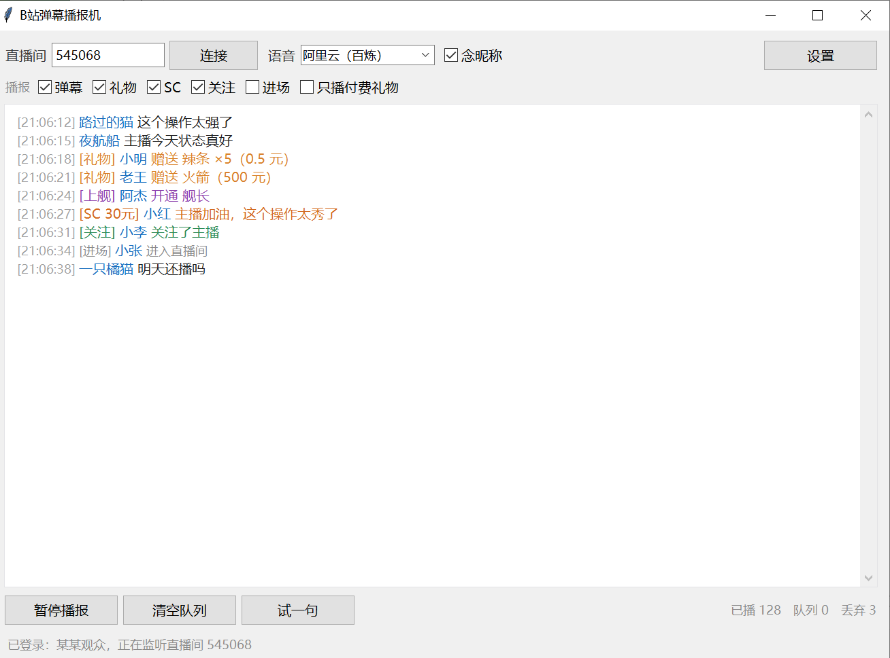

# B站弹幕播报机

连上直播间的弹幕流，进来一条念一条。礼物、醒目留言（SC）、关注、进场也能播，每一类都能单独开关。语音合成接阿里云百炼和豆包（火山引擎），界面上随时切，不用重启。



Windows 双击就能用，播放走系统自带的 MCI，不用装额外的多媒体库。

---

## 目录

1. [三分钟跑起来](#三分钟跑起来)
2. [第一次用的完整流程](#第一次用的完整流程)
3. [界面每一块是干什么的](#界面每一块是干什么的)
4. [语音密钥在哪拿](#语音密钥在哪拿)
5. [音色怎么选](#音色怎么选)
6. [设置窗口](#设置窗口)
7. [config.json 全部配置项](#configjson-全部配置项)
8. [播报文案规则](#播报文案规则)
9. [去重和限速规则](#去重和限速规则)
10. [日志](#日志)
11. [常见问题](#常见问题)
12. [诊断工具 probe.py](#诊断工具-probepy)
13. [项目结构](#项目结构)
14. [想换别的 TTS](#想换别的-tts)
15. [已知限制](#已知限制)

---

## 三分钟跑起来

1. 装 Python（3.10 以上），安装时**勾上 `Add Python to PATH`**
2. 双击 `install.bat`，等它装完（第一次要下依赖，网慢的话几分钟）
3. 双击 `run.bat`

窗口起来之后：填直播间号 → 点「连接」→ 去「设置」里填语音密钥 → 点「试一句」。

直播间号填短号（比如 `545068`），或者直接把 `https://live.bilibili.com/545068` 粘进去都行。在输入框里按回车等于点「连接」。

> 程序是用 `pythonw` 启动的，没有黑框。任何启动期报错都会写到同目录的 `error.log`，同时弹一个对话框告诉你最后一行是什么。

---

## 第一次用的完整流程

按顺序做一遍，五分钟能配完。

**第 1 步：连接房间**

1. 在顶部「直播间」输入框里填房间号
2. 点「连接」
3. 看窗口最下面的状态栏。正常会依次出现：
   - `正在解析房间…`
   - `房间号 xxxxx，正在拿弹幕服务器…`（填了 cookie 时是 `已登录：你的昵称，正在拿弹幕服务器…`）
   - `连接 wss://xxx:443/sub`
   - `已连上直播间 xxxxx，等弹幕`

看到最后一句就通了，中间那块白底列表会开始滚弹幕。颜色是有含义的：昵称蓝色、礼物橙色、SC 橙红色、上舰紫色、关注绿色、进场灰色、报错红色。

**第 2 步：选语音引擎**

顶部「语音」下拉框，三个选项：

| 选项      | 说明                                  |
| ------- | ----------------------------------- |
| 阿里云（百炼） | 需要 `sk-` 开头的 API Key                |
| 豆包（火山）  | 需要 APP ID + Access Token            |
| 静音，只记日志 | 不出声，但弹幕照样收、照样记日志。想先看看弹幕流正不正常，用这个最省事 |

切换立即生效，正在播的那条会播完。

**第 3 步：填密钥**

点右上角「设置」，切到对应标签页，填完点「保存」。

**第 4 步：试一句**

点窗口下方的「试一句」。听到「测试一下，能听到我说话吗？」就算配好了。

没声音的话，先看状态栏和列表里的红字，再对照下面的常见问题。

**第 5 步：按自己喜好调**

- 嫌进场太吵 → 把「播报」那行的「进场」勾掉
- 只想知道谁花钱了 → 勾上「只播付费礼物」
- 弹幕太快听不过来 → 设置 → 播报规则 → 把「待播队列上限」改成 3，重启程序
- 不想听某些词 → 设置 → 播报规则 → 屏蔽词，逗号分隔

---

## 界面每一块是干什么的

**顶部一行**

| 控件      | 作用                       |
| ------- | ------------------------ |
| 直播间输入框  | 填房间号或直播链接，回车直接连          |
| 连接 / 断开 | 同一个按钮，连上之后变成「断开」         |
| 语音下拉框   | 在阿里云 / 豆包 / 静音之间切        |
| 念昵称     | 打开念「小明说，主播好帅」，关掉只念「主播好帅」 |
| 设置      | 打开设置窗口（四个标签页）            |

**第二行：播报开关**（每一类独立，改了立刻生效并存盘）

| 开关     | 播报文本                 | 默认                |
| ------ | -------------------- | ----------------- |
| 弹幕     | 小明说，主播好帅             | 开                 |
| 礼物     | 感谢小明老板赠送的火箭          | 开                 |
| SC     | 感谢小明老板的30元SC，加油啊     | 开                 |
| 关注     | 感谢小明的关注              | 开                 |
| 进场     | 欢迎小明                 | **关**（人多时很吵，自己决定） |
| 只播付费礼物 | 关掉辣条、小心心这类免费礼物，只念花钱的 | 关                 |

**中间的列表**

就是弹幕流。最多保留 300 行（`ui.max_lines` 可改），超过自动删掉最上面的。列表里显示的是**收到的全部内容**，跟播不播没关系——你把「礼物」关掉了，礼物还是会在列表里出现，只是不出声。

**底部一行**

| 按钮   | 作用                                               |
| ---- | ------------------------------------------------ |
| 暂停播报 | 立刻掐掉正在播的声音，之后收到的也不念。弹幕照样收、照样记日志。恢复后只播新来的，暂停期间的不补 |
| 清空队列 | 弹幕一下涌进来时，把还没念的丢掉。用来「我不听前面那堆了，从现在开始」              |
| 试一句  | 投递一条测试语音                                         |
| 右侧统计 | `已播 N　队列 N　丢弃 N`。队列一直是满的说明你房间太热闹，或者合成太慢          |

**状态栏**（最下面一行灰字）

连接状态、登录昵称、重连提示、保存成功之类的都在这。出错时列表里还会插一条红色的 `[系统]` 消息。

---

## 语音密钥在哪拿

### 阿里云（百炼 / DashScope）

1. 登录 [阿里云百炼控制台](https://bailian.console.aliyun.com/)
2. 右上角 **API-KEY** → 创建，复制 `sk-` 开头那一串
3. 粘到 设置 → 阿里云百炼 → API Key

| 字段      | 填什么                               |
| ------- | --------------------------------- |
| API Key | `sk-xxxxxxxx`                     |
| 模型      | `cosyvoice-v3-flash`（默认就是它，别改）    |
| 音色      | `longanyang` 这种 `long` 开头的 v3 音色名 |

> 老的 `qwen-tts` 系列在 2026-10-10 全部下线了，还填这个名字会直接报 `404 Model not exist`。程序里已经做了自动兜底：配置里如果是空的或者是旧模型名，会自动换成 `cosyvoice-v3-flash` / `longanyang`。

阿里云新账号有免费额度，用完要充值。额度耗尽或欠费时合成会失败，列表里会出现红字。

### 豆包（火山引擎）

1. 登录 [火山引擎语音技术控制台](https://console.volcengine.com/speech/app)
2. 创建应用 → 开通「语音合成」服务。**记住开通的是哪个版本**
3. 抄下 **APP ID** 和 **Access Token**（不是 Secret Key，别拿错）
4. 音色 id 必须和开通的版本对应：

| 开通的服务             | 音色 id 形态                            | 举例                                                                                                   |
| ----------------- | ----------------------------------- | ---------------------------------------------------------------------------------------------------- |
| 语音合成 **2.0**（大模型） | 以 `_bigtts` 结尾，主流是 `_uranus_bigtts` | `zh_female_tianmeixiaoyuan_uranus_bigtts`、`zh_male_yunzhou_uranus_bigtts`、`zh_female_vv_mars_bigtts` |
| 语音合成 **1.0**（普通版） | 短的音色名                               | `zh_female_qingxin`                                                                                  |

> 版本和音色对不上会报 `3001 requested resource not granted`。这不是密钥问题，别去重配 token。
>
> 实测：开了 2.0 之后，103 个 `_bigtts` 结尾的音色（`_uranus_bigtts` 为主，少数 `_mars_bigtts`）全部可用；1.0 的短名基本全报 3001。所以填音色时照抄 `音色手册.html`，别自己拼后缀。

`cluster` 默认 `volcano_tts`，不用动。

**两个引擎的实测延迟**（同一条文本，家用宽带，取 3 次平均）：豆包 2.0 约 **1.7 秒**，阿里云 cosyvoice-v3-flash 约 **2.0 秒**。豆包略快，音质见仁见智，两个都留着备用最稳——一家挂了换另一家。

---

## 音色怎么选

双击 `音色手册.html`，浏览器打开一个能搜索的音色表，收了你现在这套密钥能用的全部 **124 个**音色：

- 阿里云 cosyvoice-v3-flash 的 21 个中文音色（龙安洋、龙安欢、龙应聆……）
- 豆包语音合成 2.0 的 103 个音色（Vivi 2.0、小何 2.0、云舟 2.0……）

每个都写了中文名、音色特色、适合场景，右边有个一键复制按钮——点一下音色 id 就进剪贴板，直接粘到设置里那个「音色」框。

表里所有 id 都是拿实际密钥**逐个真实合成验证过**的，复制哪个都能出声，不用赌。

换音色之后点「保存」，设置窗口关掉时引擎会重建，下一条弹幕就用新声音了。**不用重启程序。**

---

## 设置窗口

四个标签页，改完点「保存」。

**B站**

只有一项：Cookie。一般情况下不用填，报风控（-352）或者想看全昵称的时候才需要。怎么拿见常见问题第一条。

**阿里云百炼**

API Key、模型、音色三个输入框，上面有一小段说明。

**豆包（火山）**

APP ID、Access Token、音色 id。同样带说明。

**播报规则**

| 项             | 范围        | 说明                                  |
| ------------- | --------- | ----------------------------------- |
| 语速            | 0.5 ~ 2.0 | 拖滑块，1.0 是原速。改完保存立即生效（会按新语速重新合成）     |
| 音量            | 0 ~ 1     | 播放音量，**改完要重启程序才彻底生效**               |
| 单条最长字数        | ≥ 10      | 超长的截断，后面接「，后面的省略」。SC 的内容至少留 20 字    |
| 待播队列上限        | ≥ 1       | 满了就丢新来的。**改完要重启程序才生效**（队列在启动时按这个值建） |
| 屏蔽词           | 逗号分隔      | 命中就不念，不区分大小写。填 `广告,刷屏` 这样           |
| 写日志到 logs/ 目录 | 勾选        | 关掉就完全不写日志了                          |

---

## config.json 全部配置项

所有设置都存在同目录的 `config.json` 里，密码也是明文存在这。改完记得重启程序（界面里改的会自动存）。

```json
{
  "room": {
    "room_id": "545068",
    "cookie": ""
  },
  "tts": {
    "engine": "aliyun",
    "aliyun": { "api_key": "", "model": "cosyvoice-v3-flash", "voice": "longanyang" },
    "doubao": {
      "appid": "",
      "access_token": "",
      "cluster": "volcano_tts",
      "voice_type": "zh_female_vv_mars_bigtts",
      "endpoint": "https://openspeech.bytedance.com/api/v1/tts"
    },
    "speed": 1.0,
    "volume": 0.9
  },
  "broadcast": {
    "read_danmaku": true,
    "read_gift": true,
    "read_sc": true,
    "read_follow": true,
    "read_enter": false,
    "ignore_free_gift": false,
    "enter_cooldown": 600,
    "enter_per_min": 6,
    "follow_per_min": 10,
    "read_username": true,
    "username_suffix": "说，",
    "max_chars": 60,
    "max_queue": 8,
    "min_interval": 0.25,
    "skip_emoji_only": true,
    "mute_keywords": []
  },
  "log": { "enabled": true, "dir": "logs" },
  "ui": { "max_lines": 300, "always_on_top": false }
}
```

| 键                            | 默认                         | 说明                                                      | 改完要重启吗  |
| ---------------------------- | -------------------------- | ------------------------------------------------------- | ------- |
| `room.room_id`               | 空                          | 上次连的房间号，界面会自动存                                          | 否       |
| `room.cookie`                | 空                          | B站 cookie。登录后昵称不打码，也少被风控                                | 是（连接时读） |
| `tts.engine`                 | `aliyun`                   | `aliyun` / `doubao` / `none`（静音）                        | 否       |
| `tts.aliyun.api_key`         | 空                          | `sk-` 开头                                                | 否       |
| `tts.aliyun.model`           | `cosyvoice-v3-flash`       | 别填 qwen-tts，已下线                                         | 否       |
| `tts.aliyun.voice`           | `longanyang`               | v3 音色名，见音色手册                                            | 否       |
| `tts.doubao.appid`           | 空                          | 火山应用 APP ID                                             | 否       |
| `tts.doubao.access_token`    | 空                          | 火山 Access Token                                         | 否       |
| `tts.doubao.cluster`         | `volcano_tts`              | 一般不用动                                                   | 否       |
| `tts.doubao.voice_type`      | `zh_female_vv_mars_bigtts` | 必须和开通版本对应                                               | 否       |
| `tts.doubao.endpoint`        | 官方地址                       | 一般不用动                                                   | 否       |
| `tts.speed`                  | 1.0                        | 0.5 ~ 2.0                                               | 否       |
| `tts.volume`                 | 0.9                        | 0 ~ 1                                                   | **是**   |
| `broadcast.read_danmaku`     | true                       | 播弹幕                                                     | 否       |
| `broadcast.read_gift`        | true                       | 播礼物和上舰                                                  | 否       |
| `broadcast.read_sc`          | true                       | 播醒目留言                                                   | 否       |
| `broadcast.read_follow`      | true                       | 播关注                                                     | 否       |
| `broadcast.read_enter`       | false                      | 播进场                                                     | 否       |
| `broadcast.ignore_free_gift` | false                      | 只播付费礼物                                                  | 否       |
| `broadcast.enter_cooldown`   | 600                        | 同一个人进场，多少秒内只欢迎一次                                        | 否       |
| `broadcast.enter_per_min`    | 6                          | 每分钟最多播几条进场                                              | 否       |
| `broadcast.follow_per_min`   | 10                         | 每分钟最多播几条关注                                              | 否       |
| `broadcast.read_username`    | true                       | 弹幕念昵称                                                   | 否       |
| `broadcast.username_suffix`  | `说，`                       | 昵称后面接的词，可以改成 `：` 或空字符串                                  | 否       |
| `broadcast.max_chars`        | 60                         | 单条最长字数，改小了省合成时间                                         | 否       |
| `broadcast.max_queue`        | 8                          | 待播队列上限                                                  | **是**   |
| `broadcast.min_interval`     | 0.25                       | 两条之间最短间隔（秒），调大能拉开节奏                                     | **是**   |
| `broadcast.skip_emoji_only`  | true                       | 预留项，目前没接（纯表情已经由文本清洗兜住了）                                 | —       |
| `broadcast.mute_keywords`    | `[]`                       | 屏蔽词数组                                                   | 否       |
| `log.enabled`                | true                       | 写不写日志                                                   | 否       |
| `log.dir`                    | `logs`                     | 日志目录，相对本目录                                              | 是       |
| `ui.max_lines`               | 300                        | 列表最多留多少行                                                | 否       |
| `ui.always_on_top`           | false                      | 预留项，目前没接（想要置顶可以自己加 `self.attributes("-topmost", True)`） | —       |

> 手改 JSON 时注意别把逗号写错。写坏了程序启动会自动回退到默认配置（**不会覆盖你的文件**，但界面里就全是默认值了）。想重来，直接把 `config.json` 删掉，下次启动重新生成。

---

## 播报文案规则

| 事件     | 文案                      | 举例               |
| ------ | ----------------------- | ---------------- |
| 弹幕     | `{昵称}说，{内容}`            | 小明说，主播好帅         |
| 礼物     | `感谢{昵称}老板赠送的{礼物}`       | 感谢小明老板赠送的火箭      |
| 礼物（连发） | `感谢{昵称}老板赠送的{N}个{礼物}`   | 感谢小明老板赠送的5个辣条    |
| 上舰     | `感谢{昵称}老板开通的{舰长/提督/总督}` | 感谢小明老板开通的舰长      |
| SC     | `感谢{昵称}老板的{N}元SC，{内容}`  | 感谢小明老板的30元SC，加油啊 |
| 关注     | `感谢{昵称}的关注`             | 感谢小明的关注          |
| 进场     | `欢迎{昵称}`                | 欢迎小明             |

弹幕文本在念之前会被洗一遍，避免 TTS 把乱七八糟的东西一个字母一个字母念出来：

- 表情占位符 `[doge]`、`[大笑]` 这类方括号内容直接删掉
- 链接、`@某人` 删掉
- 连续重复 5 个以上的字符压成 3 个（`哈哈哈哈哈哈哈` → `哈哈哈`）
- 只剩标点或数字的，整条不念
- 超过 `max_chars` 的截断，念成「……，后面的省略」
- 命中屏蔽词的整条不念

---

## 去重和限速规则

弹幕比嘴快，所以必须做减法。规则都在 `broadcast` 里，改完不用重启。

| 事件      | 规则                                                                      |
| ------- | ----------------------------------------------------------------------- |
| 弹幕      | 不限量，靠队列上限和播报速度自然削峰                                                      |
| 礼物 / 上舰 | 同一个人 + 同一个礼物，**3 秒内只念一次**。连击（x10、x99）只念第一条，不会十条全念                       |
| 进场      | 同一个人 **10 分钟**内只欢迎一次（`enter_cooldown`）；全局**每分钟最多 6 条**（`enter_per_min`） |
| 关注      | 全局**每分钟最多 10 条**（`follow_per_min`），超了就只显示不念                             |
| SC      | 全部念，走优先队列                                                               |

**优先级**：礼物 / 上舰 / SC 走优先队列，队列挤的时候会插到普通弹幕前面。所以哪怕弹幕堆了 8 条，刚收到的火箭也会先念。

**队列满了怎么办**：丢掉新来的，右边「丢弃」计数 +1。为什么不丢旧的？因为旧的可能已经在合成、已经在播了，丢掉更浪费。

**为什么进场默认是关的**：热门房间一秒钟能进十几个人，全念出来就没有弹幕什么事了。想开就把开关勾上，自带上面那套限速。

---

## 日志

每天一个文件，在 `logs/danmu-YYYY-MM-DD.jsonl`，一行一条：

```json
{"time":"2026-10-18 15:48:06","user":"小明","text":"主播好帅[doge]","tts_text":"小明说，主播好帅","type":"danmaku","engine":"aliyun","status":"ok"}
```

| 字段         | 说明                                                                |
| ---------- | ----------------------------------------------------------------- |
| `time`     | 播报时刻                                                              |
| `user`     | 昵称                                                                |
| `text`     | 原始内容（礼物是「赠送 火箭 x1」这种）                                             |
| `tts_text` | 实际念出来的完整句子                                                        |
| `type`     | `danmaku` / `gift` / `guard` / `sc` / `follow` / `enter`          |
| `engine`   | `aliyun` / `doubao` / `none`                                      |
| `status`   | `ok` 成功；`muted` 静音模式没出声；`tts_error: xxx` 合成失败；`error: xxx` 播放阶段出错 |

想统计谁刷得最多：

```bash
.venv\Scripts\python.exe -c "import json,collections;c=collections.Counter(json.loads(l)['user'] for l in open('logs/danmu-2026-10-18.jsonl',encoding='utf-8'));print(c.most_common(10))"
```

日志只在**程序启动时**清理一次，保留最近 30 天（`DanmuLogger` 里写死的 `keep_days=30`）。

---

## 常见问题

### 装不上 / 起不来

**双击 `run.bat`，黑框闪一下就没了**

现在的版本不会闪——检测到没装环境会自动调 `install.bat`，并且所有报错都有提示。如果还是闪：

1. 右键 `run.bat` → 编辑，确认文件是正常文本（之前有个版本因为换行符是 LF 导致 cmd 直接退出，已经改成 CRLF 了）
2. 手动开个命令行，跑 `.venv\Scripts\python.exe main.py`，报错会直接打在屏幕上
3. 看同目录的 `error.log`

**提示「没找到 python」**

装 Python 时没勾 `Add Python to PATH`。重装一遍并勾上，或者手动把 Python 目录加到环境变量。

**`install.bat` 卡在 pip 下载**

国内网访问 pypi 慢。打开命令行手动换源装：

```bash
.venv\Scripts\python.exe -m pip install -r requirements.txt -i https://pypi.tuna.tsinghua.edu.cn/simple
```

**报 `No module named tkinter`**

Microsoft Store 版的 Python 不带 tkinter。去 [python.org](https://www.python.org/downloads/) 下官方安装包，重装时勾上 `tcl/tk and IDLE`，然后删掉 `.venv` 重新跑 `install.bat`。

**窗口小得像个巴掌 / 字发虚**

程序已经按系统缩放比例放大了。如果还是不对，把显示设置的缩放改成 100% 或 125% 试试；远程桌面下也会出现这种比例错乱。

**杀毒软件报毒 / 拦下 pythonw**


正常现象，无签名的小工具容易被误报。加白名单即可。

### 连不上直播间

**连接失败，提示 -352**

B站风控。解决：浏览器登录 B站 → F12 → Network → 随便点一个请求 → 复制请求头里的 Cookie 整串 → 粘到 设置 → B站 → Cookie。

不用全填，`SESSDATA=` 和 `buvid3=` 两段就够。

填的姿势很宽松，这几种都认：

- 完整串 `SESSDATA=xxx; buvid3=yyy; ...`
- 只粘 `SESSDATA` 的值（插件里复制 value 就长这样）
- 带 `Cookie:` 前缀
- 多行粘贴，一行一个
- Cookie-Editor 导出的 JSON 数组

**填了 cookie 之后一直「连接断开，2s 后重连」**

这是旧版本的坑，已经修了。原因很隐蔽：带 SESSDATA 却用 `uid=0` 去连弹幕服务器，B站会立刻掐断连接。现在程序会先查 `/x/web-interface/nav` 拿到真实 uid，再把 cookie 一起塞进握手头。

连上之后状态栏会显示 `已登录：你的昵称`，看到这句就说明 cookie 生效了。

如果**现在**还出现这个循环，按顺序排查：

1. 状态栏是不是 `cookie 没生效（未登录）` → SESSDATA 过期了，重新复制一个
2. 是不是挂了 VPN / 公司代理 → 弹幕服务器在国内，程序已经强制直连 WebSocket，但 HTTP 那几步仍可能走系统代理
3. 换一个热门房间试试，排除房间本身的问题
4. 看是不是 `鉴权失败 code=xxx`，那是 token 过期，断开重连一次会自己刷新

**提示「房间号解析失败」/「看不懂这个直播间号」**

房间号填错了，或者那个直播间不存在。长号短号都支持，也支持粘完整链接，但链接必须是 `live.bilibili.com/数字` 这种形式。

**连上了但一条弹幕都没有**

先确认房间真在播。跑一下诊断脚本（见下面 probe.py）。如果只有 `WATCHED_CHANGE` 没有 `DANMU_MSG`，就是这个房间没人说话，换个热闹的试试。刚开播的房间、或者主播没开麦的，可能真的是一条都没有。

**弹幕有，但列表不滚 / 界面卡住**

极少见。关掉重开一次基本就好。如果频繁出现，把 `ui.max_lines` 调小（比如 150）。

### 播出来的内容不对

**昵称显示成 `那***` 这种**

没登录，或者 SESSDATA 过期了。要念全名必须填有效 cookie；不填照样能播，只是名字被打码成 `那***`。

**礼物念成「感谢小明老板赠送的礼物」，没有具体名字**

免费礼物（辣条、小心心那类）的服务端数据里只给了礼物 id，没带名字，只能兜底念「礼物」。付费礼物一般带名字。

不想听这些就勾上「只播付费礼物」——判断依据是金瓜子支付或者价值 ≥ 0.1 元。

**礼物连击只念了一次**

故意的。同一个人同一个礼物 3 秒内只念一条，不然 x99 的连击能把队列堵死。

**进场太吵了 / 进场一条都不念**

进场默认是关的。想开就勾「进场」，自带每分钟 6 条、同一个人 10 分钟的限速。觉得还是多，把 `enter_per_min` 调到 2。

**弹幕太快，念不过来，右边「丢弃」一直涨**

正常。三个办法：把「待播队列上限」调到 3（重启），把 `min_interval` 调大到 0.5，或者干脆把弹幕播报关掉只听礼物和 SC。

**弹幕里带的表情被念出来了**

`[doge]` 这种方括号占位符会被洗掉。但如果有人发了纯 emoji（😀 这种），可能会被念成奇怪的词。加进屏蔽词也拦不住（屏蔽词是按子串匹配文本），直接忽略就行。

**长弹幕被截断了**

`max_chars` 默认 60 字，超过念「……，后面的省略」。想放宽就改大，但每多一个字合成就多一点延迟。

**某个词不想听**

设置 → 播报规则 → 屏蔽词，逗号分隔，不区分大小写。命中就整条不念（不是只把词抹掉）。

### 没声音 / 语音报错

**点了「试一句」没反应**

1. 看状态栏，有没有 `阿里云还没填密钥，去设置里补一下`
2. 看列表里有没有红字。合成失败的具体原因都会打在这
3. 检查系统音量、输出设备、有没有插耳机
4. 静音引擎（`静音，只记日志`）是不会出声的，确认下拉框选对了

**阿里云报 404 `Model not exist`**

模型名不对，或者用了已下线的老模型（`qwen-tts` 那套 2026-10-10 就停了）。设置里把模型改成 `cosyvoice-v3-flash`。

**阿里云报 `InvalidApiKey` / 401**

Key 复制少了几位，或者这个 Key 被删了。重新去控制台建一个。

**阿里云报欠费 / 限流（`Arrearage`、`Throttling`）**

免费额度用完了，或者调用太频繁触发限流。去控制台看额度，或者换豆包。

**阿里云没返回音频**

音色名和模型对不上。`cosyvoice-v3-flash` 只认 v3 那套 `long` 开头的音色，别填 `Cherry`、`Serena` 这些（那是 qwen-tts 时代的）。

**豆包报 `3001 requested resource not granted`**

八成是音色版本不对，不是密钥问题。去控制台确认开通的是 1.0 还是 2.0，然后按上面的表填对应形态的音色 id。

如果确认音色对了还报，那就是应用没勾「语音合成」权限，或者这个 token 是别的应用的。

**豆包报 HTTP 401**

Access Token 错了，或者拿成了 Secret Key。另外这个接口的 Authorization 头是 `Bearer;token`（分号），不是空格——程序里已经按官方要求写好了，你自己改代码时注意。

**豆包报 `3003` / `3005` / 其他 code**

`3003` 一般是文本为空或过长，`3005` 是后端超时（重试通常就好）。看 `message` 里的具体描述。

**换了音色，试听却是老声音**

这个 bug 修过了。原因是缓存文件名没把音色算进指纹，同一句话一直命中旧文件。现在缓存指纹包含「引擎 + 模型 + 音色 + cluster + 语速」，换音色会重新合成。

如果还遇到，直接把 `.cache_tts` 文件夹删掉再试。

**声音太快 / 太慢 / 太小声**

设置 → 播报规则。语速 0.5~2.0，音量 0~1。**音量改完要重启程序**，因为播放器音量是启动时读的。语速改完保存就生效。

**延迟有点大，弹幕都过去两秒了才念**

单条合成就是 1.5~2 秒，这是云端 TTS 的固有延迟，改不了。缓解办法：把 `max_chars` 调小（短句更快），队列上限调到 3~4，或者选延迟稍低的豆包。

### 其他

**密钥会不会泄露**

`config.json` 是**明文**存在本地的，里面有阿里云 API Key、豆包 token、B站 cookie。别把这个文件发给别人，截图时注意躲开。`.cache_tts` 里是合成好的音频，没有密钥，可以随便删。

**换电脑怎么迁移**

把整个文件夹拷过去，但**删掉 `.venv`**（虚拟环境绑定了原来的路径），然后在新机器上重新跑 `install.bat`。`config.json`、`logs`、`音色手册.html` 都能直接带过去。

**能同时开两个窗口听两个房间吗**

理论上可以，但两个实例共用同一个 `config.json` 和 `logs`，会互相覆盖配置。真想这么用，复制两份文件夹。

**`.cache_tts` 越来越大**

确实不会自动清理。好处是重复的句子（比如同一句「感谢小明老板赠送的辣条」）不用重复调接口，省额度也省延迟。8MB / 100 多条是正常量级，觉得占地方就整个删掉，下次用到会重新合成。

---

## 诊断工具 probe.py

如果怀疑是连接问题，用这个脚本单独看一眼，它不开界面、不合成语音，只打印收到了什么：

```bash
.venv\Scripts\python.exe probe.py 545068 20
```

参数是「房间号」和「观察秒数」，默认 `7734200` 和 20 秒。

输出长这样：

```
房间 545068 host tx-bj-live-comet-02.chat.bilibili.com
  状态: 连接 wss://tx-bj-live-comet-02.chat.bilibili.com:443/sub
  状态: 已连上直播间 545068，等弹幕
  弹幕: {'type': 'danmaku', 'user': '小明', 'text': '主播好帅', ...}
  ...
cmd 分布: {'DANMU_MSG': 49, 'INTERACT_WORD_V2': 97, 'WATCHED_CHANGE': 12}
弹幕数: 49
```

`cmd` 分布能告诉你这个房间到底有什么消息：全是 `INTERACT_WORD_V2` 说明只有人进进出出没人说话；连 `WATCHED_CHANGE` 都没有，那就是房间号错了或者根本没开播。

注意 `probe.py` 是游客身份连的，不带 cookie，所以昵称会打码。它和界面程序可以同时开。

---

## 项目结构

```
bili-danmu-tts/
├── main.py              入口（DPI 感知 + 启动异常兜底）
├── run.bat              双击启动，没环境会自动装
├── install.bat          建 .venv 装依赖
├── probe.py             诊断脚本，看某个房间有没有弹幕
├── 音色手册.html        124 个音色，带搜索和一键复制
├── config.json          运行时生成，密钥都在这（别外传；仓库里不带这个文件）
├── config.example.json  配置模板，全是默认值
├── .gitignore           排除 .venv / config.json / logs / 缓存
├── error.log            启动失败时才有
├── screenshot.png       界面截图
├── .cache_tts/          合成音频缓存，可随时删
├── logs/                每天一个 jsonl
└── app/
    ├── ui.py            tkinter 界面、设置窗口、去重限速
    ├── bili_client.py   房间号解析、wbi 签名、弹幕服务器地址
    ├── danmu_ws.py      websocket 收包解包、事件分发、断线重连
    ├── pb.py            极简 protobuf 解码（新版的礼物/进场是二进制）
    ├── player.py        MCI 播放 + 播报队列（优先队列）
    ├── utils.py         弹幕文本清洗、按事件类型拼文案
    ├── logger.py        jsonl 日志
    ├── config.py        配置读写与默认值
    └── tts/             语音引擎
        ├── base.py      接口定义、缓存指纹
        ├── aliyun.py    cosyvoice（dashscope SDK）
        ├── doubao.py    火山 HTTP 接口
        └── __init__.py  按配置造引擎
```

---

## 想换别的 TTS

在 `app/tts/` 新建一个文件，继承 `BaseTTS`，实现两个方法：

```python
from .base import BaseTTS, TTSError

class MyTTS(BaseTTS):
    name = "mytts"      # 日志里的 engine 字段
    ext = "mp3"         # 输出格式，mp3/wav 都行

    def is_ready(self) -> bool:
        return bool(self.conf.get("api_key"))

    def synthesize(self, text, out_dir):
        out = self._out_path(text, out_dir)   # 自动带缓存
        if out.exists() and out.stat().st_size > 512:
            return out
        # 调你的接口，把音频写进 out
        out.write_bytes(audio_bytes)
        return out
```

然后在 `app/tts/__init__.py` 的 `build_engine` 里加一个分支，再把引擎名加进 `app/ui.py` 顶部的 `ENGINES` 字典。

`voice_tag()` 决定缓存指纹，默认包含 name / model / voice / cluster / speed。如果你的引擎还有别的会影响音色的参数，记得一起塞进去——不然换参数听不出区别（这个坑踩过了）。

`conf` 里能拿到 `tts.speed` 和 `tts.volume`，由 `build_engine` 塞进去的。

Windows 上播放用的是 MCI（`winmm`），mp3 和 wav 都吃。macOS / Linux 下会退回 pygame，需要 `pip install pygame`。

---

## 已知限制

- **免费礼物没有名字**：辣条、小心心这类，服务端 protobuf 里只给 id，只能念「礼物」。建议开「只播付费礼物」。
- **付费大额礼物没实机验证过**：火箭、电池这类字段结构和免费礼物不一样，理论上走同一条路径，但如果播报文案里数字不对，把日志里那行发我看看。
- **两个配置项是预留的**：`broadcast.skip_emoji_only` 和 `ui.always_on_top` 目前没接到代码上，改了不起作用（纯表情已经被文本清洗兜住了；窗口置顶要自己加一行）。
- **音量要重启**：播放器音量在后台线程启动时读一次，滑块改动重启后生效。
- **只支持 Windows 10/11**：核心的弹幕协议是跨平台的，但播放走 MCI，mac/linux 得自己装 pygame。
- **不做弹幕发送、不做礼物答谢、不存数据库**：这就是个「收弹幕 → 念出来 → 记一行日志」的小东西，别指望它干别的。
